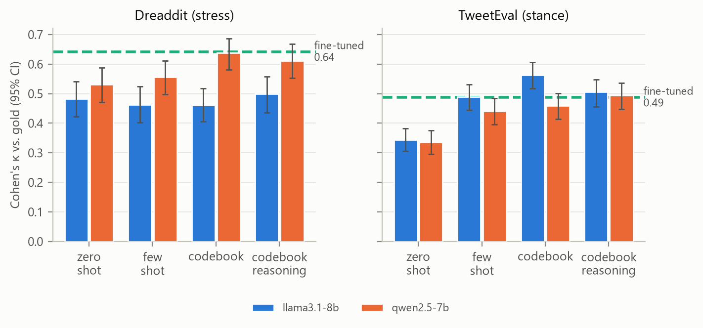
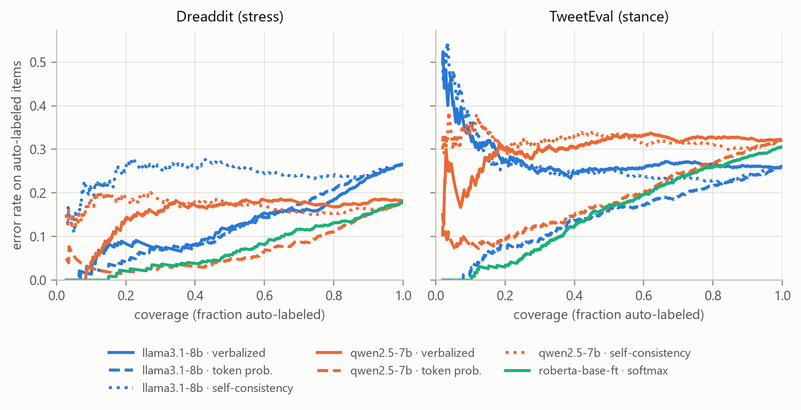

# RaterBench

Researchers in psychology, public health and the social sciences are starting to use LLMs to
label text that trained annotators used to label. It's cheaper and faster, but how good are the
labels, and can you tell which ones to trust? RaterBench is my attempt to answer that carefully.
It scores LLM labels against human expert labels with the same statistics people use for
inter-rater reliability, and it tests whether a model's confidence is good enough to decide which
items still need a human.

I ran two open models (Llama 3.1 8B and Qwen 2.5 7B, through Ollama) on two tasks, with four
prompting strategies each, for 40,842 labels in total, and compared them with a fine-tuned
RoBERTa baseline. The write-up is a 4-page report: [`report/main.pdf`](report/main.pdf).

## What I found

How you prompt matters about as much as which model you use. With a detailed annotation codebook
in the prompt, each LLM matches the fine-tuned RoBERTa baseline on one task. Qwen does it on
stress detection (Cohen's κ 0.64 vs. 0.64, McNemar p = 1.00), and Llama on stance detection
(κ 0.56 vs. 0.49, p = 0.14). Zero-shot prompting is significantly worse in every case, and on
stance both models only reach κ 0.34.

There's no single best model. Qwen is better at stress and Llama at stance, and both differences
are significant (p < 0.001).

Only one confidence signal turned out to be useful: the probability the model assigns to the
label tokens. It separates right from wrong answers with an AUROC of 0.69–0.80. When asked how
confident they are, the models answer with at most 6 distinct values (AUROC 0.52–0.77). Sampling
five more answers at temperature 0.7 barely changes anything (AUROC 0.54–0.58).

That matters for triage. With split conformal prediction at a 90% coverage target, Qwen's token
probabilities send 15% of Dreaddit items to a human, and the auto-labeled rest has 13.0% error,
compared with 18.2% if every item were auto-labeled. Stance is harder: the best LLM still sends
56% of items to a human, and self-consistency sends all of them. Empirical coverage landed in the
expected range in all 56 settings I tested.

The labels aren't fully stable either. They flip for 6.9–9.0% of meaning-preserving paraphrases,
2.9–8.0% of typo edits and 1.7–3.3% of gender swaps.

Finally, a lot of "errors" are really problems with the gold labels. In a coded sample of 100 LLM
errors, 27 point to a debatable or wrong gold label. On Dreaddit, 20 of 50 come from a mismatch
between the codebook (which asks about the writer's current state) and the crowd annotators (who
often labeled by topic). I drafted these codes with a language model and reviewed every one
myself ([`results/analysis/table9_error_taxonomy.md`](results/analysis/table9_error_taxonomy.md)).

All of these numbers are produced by the scripts in this repo; see
[`results/analysis/`](results/analysis/) and
[`report/generated/numbers.tex`](report/generated/numbers.tex).

## Results

Agreement with the gold labels on the evaluation sets (Cohen's κ with a 95% bootstrap interval):

| Model | Prompt | Dreaddit κ [95% CI] | TweetEval κ [95% CI] |
|---|---|---|---|
| Majority class | -- | 0.00 [0.00, 0.00] | 0.00 [0.00, 0.00] |
| RoBERTa-base (fine-tuned) | -- | 0.64 [0.58, 0.69] | 0.49 [0.44, 0.53] |
| Llama 3.1 8B | zero-shot | 0.48 [0.42, 0.54] | 0.34 [0.31, 0.38] |
| Llama 3.1 8B | few-shot | 0.46 [0.40, 0.52] | 0.49 [0.44, 0.53] |
| Llama 3.1 8B | codebook | 0.46 [0.41, 0.52] | **0.56** [0.52, 0.61] |
| Llama 3.1 8B | codebook+reason | 0.50 [0.44, 0.56] | 0.51 [0.46, 0.55] |
| Qwen 2.5 7B | zero-shot | 0.53 [0.47, 0.59] | 0.34 [0.30, 0.38] |
| Qwen 2.5 7B | few-shot | 0.56 [0.50, 0.61] | 0.44 [0.40, 0.48] |
| Qwen 2.5 7B | codebook | **0.64** [0.58, 0.69] | 0.46 [0.41, 0.50] |
| Qwen 2.5 7B | codebook+reason | 0.61 [0.55, 0.67] | 0.49 [0.45, 0.54] |

There are 715 evaluation items for Dreaddit and 1,000 for TweetEval. Macro-F1, Krippendorff's α,
accuracy and every significance test are in [`results/analysis/`](results/analysis/).





There are also [reliability diagrams](results/analysis/figures/fig3_reliability.png) and a
[per-subgroup breakdown](results/analysis/figures/fig7_subgroups.png).

## The data

- **Dreaddit** (Turcan & McKeown, 2019): Reddit post excerpts labeled for stress, from ten
  subreddits grouped into five domains.
- **TweetEval stance** (Barbieri et al., 2020, from SemEval-2016 Task 6): tweets labeled
  favor / against / none toward one of five targets.

[data/DATASETS.md](data/DATASETS.md) has the sources, licenses, exact sizes and how the
evaluation and calibration samples were drawn. The raw text isn't in this repo; the download
script fetches it and checks it against pinned checksums.

## How it's measured

- **Agreement:** accuracy, macro-F1, Cohen's κ and Krippendorff's α, each with a 1,000-resample
  bootstrap interval, plus exact McNemar tests with Holm correction for comparing setups.
- **Calibration:** three confidence signals (what the model says, the label's token probability,
  and agreement across 5 samples at temperature 0.7), scored with ECE, Brier score, AUROC and
  reliability diagrams.
- **Triage:** split conformal prediction (LAC and APS) at 90% and 95% target coverage, fitted on
  a held-out calibration set. I report how many items go to a human and how often the
  auto-labeled ones are wrong.
- **Bias and robustness:** per-subgroup macro-F1 with χ² tests, and label flips under gender
  swaps, typos and paraphrases.

## Running it yourself

You'll need [uv](https://docs.astral.sh/uv/), [Ollama](https://ollama.com) and, for the RoBERTa
baseline, an NVIDIA GPU. Install the environment, then fetch and check the data:

```bash
uv sync --extra train
```

```bash
uv run raterbench data download
```

```bash
uv run raterbench data stats
```

Pull the two models:

```bash
ollama pull llama3.1:8b
```

```bash
ollama pull qwen2.5:7b
```

Run the full benchmark. It took about 3.6 hours on my laptop's RTX 5070. Every call is cached,
so if it stops you can run it again and it picks up where it left off.

```bash
uv run raterbench run --config configs/full_local.yaml
```

Then the baseline, the perturbation test, the analysis, and the report's tables:

```bash
uv run raterbench baselines --config configs/baselines.yaml
```

```bash
uv run raterbench perturb --config configs/perturb.yaml
```

```bash
uv run raterbench analyze
```

```bash
uv run raterbench report-assets
```

To build the PDF, run `pdflatex main`, `bibtex main` and `pdflatex main` twice inside `report/`.
If you just want to check that everything works, `configs/dryrun.yaml` runs a 20-item version.

Tests and lint:

```bash
uv run pytest
```

```bash
uv run ruff check .
```

## What's in the repo

```
configs/      run, model, dataset, baseline, perturbation and analysis settings
data/         dataset notes and the fixed sample IDs (raw data is downloaded, not committed)
prompts/      prompt templates, task definitions and annotation codebooks
src/raterbench/
  data/       loaders, checksummed downloads, stratified sampling
  llm/        LLM client with Anthropic and Ollama backends, response cache, cost cap
  prompting/  prompt rendering and strict JSON parsing
  baselines/  majority class and fine-tuned encoder
  metrics/    agreement, calibration, conformal prediction, subgroups, statistical tests
  perturb/    the counterfactual edits
  analysis/   tables, figures, error coding and report assets
results/      tables, figures, baseline metrics, perturbation results and error samples
report/       LaTeX source and the compiled PDF
tests/        pytest suite
```

## Limitations

- I only tested two small open models, quantized to 4 bits. Bigger or proprietary models could
  behave quite differently. The Anthropic API backend is implemented but I didn't run it.
- The gold labels aren't perfect. Dreaddit's own annotators only reached moderate agreement
  (Fleiss' κ = 0.47 in the original paper), so a disagreement isn't always the model's fault.
- Dreaddit's test split was too small to split again, so its calibration set comes from the
  training split. That makes the conformal guarantee approximate for Dreaddit.
- The subgroups are topics and communities, not demographic groups, so this is a limited bias
  audit, and I didn't correct the subgroup tests for multiple comparisons.
- Qwen wrote the paraphrases, and it's also one of the models being tested. It sometimes softens
  emotional language, so some "flips" may be real changes in meaning.
- Each LLM result is a single run at temperature 0; the RoBERTa baseline uses three seeds.
- The error taxonomy has one coder (codes drafted with a language model, then reviewed by me),
  so there's no inter-coder agreement to report.
- I didn't build the review web app I'd originally planned, and I left out the optional
  GoEmotions comparison.

## Data use and ethics

Both datasets are public social-media text released for research. I don't redistribute any of the
text, only item IDs and hashes. There's no clinical data here and no clinical claim: an LLM
saying a post shows stress is not a mental-health assessment. Neither dataset comes with an
explicit license, so [data/DATASETS.md](data/DATASETS.md) lists the terms that apply.

## References

- Turcan, E. & McKeown, K. (2019). *Dreaddit: A Reddit Dataset for Stress Analysis in Social
  Media.* LOUHI 2019.
- Barbieri, F. et al. (2020). *TweetEval: Unified Benchmark and Comparative Evaluation for Tweet
  Classification.* Findings of EMNLP 2020.
- Mohammad, S. et al. (2016). *SemEval-2016 Task 6: Detecting Stance in Tweets.*

Licensed under MIT; see [LICENSE](LICENSE).
